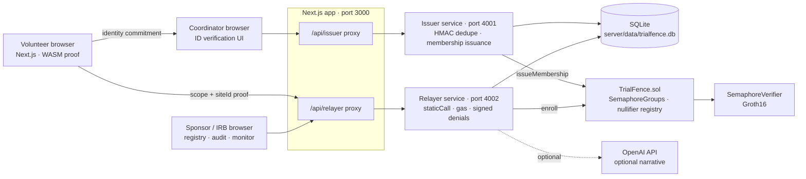

# TrialFence

**Privacy-preserving duplicate-enrollment gate for multi-site clinical trials.**

[](https://github.com/alwaysalearner1234/Trial_fence/actions/workflows/ci.yml)


**[Live Demo](https://trialfence-frontend.onrender.com/)** · **[Video Demo](#)** · **[Pitch Deck](TrialFence_Phase2_Pitch_Deck.pdf)**

TrialFence lets a participant enroll at only one site per clinical-trial protocol without exposing identity.
A coordinator verifies physical ID documents off-chain; only a one-way identity commitment and a Semaphore
membership proof reach the chain. A protocol-scoped nullifier blocks the same participant at a second site,
while enrollments in different protocols stay unlinkable.

## Problem Statement

Multi-site trials need to stop the same person from enrolling twice — whether by mistake or to claim two
stipends — across sites that do not share participant records by default. Centralizing names or document
numbers to deduplicate conflicts with HIPAA/GDPR minimization and creates a high-value breach target.
TrialFence replaces the shared identity database with a cryptographic gate: sites learn "already enrolled"
or "accepted," never who the participant is.

| Without TrialFence | With TrialFence |
|---|---|
| Sites share participant PII to deduplicate | Only commitments and nullifiers are shared |
| Duplicate detection depends on manual checks | On-chain nullifier registry rejects duplicates deterministically |
| One identity database becomes a breach target | No names or raw document numbers leave the coordinator |
| Cross-site linkage is implicit | Nullifiers are scope-bound; cross-protocol enrollments do not link |

## Why It Works

- **One ad-hoc Semaphore group** (`GROUP_ID = 1`) on `TrialFence.sol`. Only the issuer can `issueMembership` / `removeMembership`.
- **The proof binds protocol and site.** `scope = keccak256("TrialFence-Protocol-v1:" ‖ protocolId)` (mirrored in `server/src/scope.ts` and `web/src/lib/scope.ts`), and the proof `message` is the `siteId`. A wrong protocol reverts with `TrialFence__WrongScope`; a wrong site reverts with `TrialFence__SiteMismatch`.
- **Groth16 verification is on-chain.** The proof is checked by the Semaphore verifier referenced by the contract; an invalid proof reverts with `TrialFence__InvalidProof`.
- **Duplicates are blocked by the nullifier.** The nullifier is derived from the identity secret and the scope, so the same participant at a second site in the same protocol produces the same nullifier → `TrialFence__DuplicateEnrollment`. A different protocol produces an unrelated nullifier.
- **Stale roots expire.** Membership changes mark the previous Merkle root superseded; in-flight proofs remain valid for `MERKLE_TREE_DURATION` (1 hour), then revert with `TrialFence__MerkleTreeRootIsExpired`.
- **No PII on-chain.** Events carry only `protocolId`, `siteId`, `scope`, `nullifier`, `root`, and the relayer address. The issuer stores HMAC keyed-digests of document numbers — never names or raw numbers.

| Contract revert | Relayer reason | Meaning |
|---|---|---|
| `TrialFence__DuplicateEnrollment` | `DUPLICATE` | Nullifier already consumed for this protocol |
| `TrialFence__WrongScope` | `WRONG_SCOPE` | Proof was built for another protocol |
| `TrialFence__SiteMismatch` | `SITE_MISMATCH` | Proof message is not the submitting site |
| `TrialFence__InvalidProof` | `INVALID_PROOF` | Groth16 verification failed |
| `TrialFence__ProtocolNotFound` / `TrialFence__SiteNotFound` | `PROTOCOL_NOT_FOUND` / `SITE_NOT_FOUND` | Registry entry missing |
| `TrialFence__MerkleTreeRootIsExpired` | `STALE_ROOT` | Root older than the 1-hour window |

## System Architecture



### Component Breakdown

| Module | Responsibility | Design rationale |
|---|---|---|
| `contracts/contracts/TrialFence.sol` | Protocol/site registry, issuer-gated group membership, Groth16 enrollment gate, nullifier registry | The duplicate check must be verifiable and tamper-evident; the chain is the neutral arbiter across sites |
| `contracts/scripts/deploy.ts` | Deploys `SemaphoreVerifier`, `PoseidonT3`, and `TrialFence`; aligns owner/issuer keys; funds accounts with `hardhat_setBalance` | Prevents `NotOwner` / `NotIssuer` failures caused by mismatched local keys |
| `server/src/issuer` | `POST /register` — verifies a test document once, HMAC-dedupes it, issues membership | Identity verification stays off-chain and centralized at the issuer boundary |
| `server/src/relayer` | Protocol/site registration, `POST /enroll` preflight via `staticCall`, gas payment, signed denial records, `/events`, `/monitor/summary` | Separates the participant-facing gate from key custody; the browser never holds a wallet key |
| `server/src/monitor.ts` | Deterministic, PII-free anomaly flags over public events and denial records; optional LLM narrative | Auditing must not require access to participant identity |
| `server/src/db.ts` | SQLite (`node:sqlite`) mirrors: identities, members, denials, protocols, sites | Local prototype store; schema is portable to Postgres |
| `web/` | Next.js 15 App Router: volunteer, coordinator, sponsor/IRB flows; same-origin API proxies | Avoids CORS in the browser and keeps service URLs server-side |
| `scripts/render-start.mjs` | Single-service boot: local chain → deploy → issuer/relayer → Next.js; hosted mode reuses an existing deployment | One command for demos without collapsing the service boundaries |

## Core Workflows & Data Flow

**Enrollment (accepted).**

1. The volunteer page creates a Semaphore `Identity` and stores its export in `localStorage`; the commitment is the only value shared with the coordinator.
2. `POST /register` on the issuer (port 4001) receives the commitment plus a test document number and name. The issuer HMACs the document number, rejects a repeated digest, calls `issueMembership(commitment)` on-chain, and mirrors the member locally.
3. The volunteer page reads registered protocols/sites and `GET /members`, rebuilds the group, and calls `generateProof(identity, group, siteId, scope)` in WebAssembly.
4. `POST /enroll` on the relayer (port 4002) validates the payload, re-checks the scope, runs `contract.enroll.staticCall(...)`, then submits the transaction with the relayer key and a nonce obtained via `eth_getTransactionCount`.
5. On success the relayer returns `txHash`, `blockNumber`, `nullifier`, `scope`, and an explorer link; `EnrollmentAccepted` is readable through `GET /events`.

**Enrollment (denied).** A classified revert (duplicate, wrong scope, site mismatch, invalid proof, missing registry entry, stale root) is returned as `status: "denied"` and persisted as a relayer-signed, PII-free record. The digest uses ABI-encoded `["TRIALFENCE_DENIAL_V2", protocolId, siteId, nullifier, reason, createdAt]`; `GET /denials/:id/verify` recovers the signer. Transport failures and unclassified errors return `503 CHAIN_UNAVAILABLE` and are **not** recorded as denials.

**Registry.** `POST /protocol` and `POST /site` are gated by `RELAYER_API_KEY`, signed by the owner key, and mirrored to SQLite for dashboard reads (`GET /protocols`, `GET /sites`, `GET /config`).

## Project Structure

```
.
├── contracts/
│   ├── contracts/TrialFence.sol        # registry + enrollment gate
│   ├── scripts/deploy.ts               # local/Amoy deployment, key alignment
│   ├── test/TrialFence.test.ts         # 22 tests with real Groth16 proofs
│   ├── deployments/                    # localhost.json / amoy.json
│   └── hardhat.config.ts               # Solidity 0.8.28, localhost + amoy networks
├── server/
│   └── src/
│       ├── issuer/index.ts             # port 4001 — register + membership
│       ├── relayer/index.ts            # port 4002 — enroll, registry, denials
│       ├── monitor.ts                  # anomaly flags + optional LLM narrative
│       ├── chain.ts                    # provider, wallets, nonce handling
│       ├── db.ts                       # SQLite schema + additive migrations
│       ├── config.ts                   # env parsing, repo-relative paths
│       └── scope.ts                    # keccak256 scope mirror
├── web/
│   ├── src/app/page.tsx                # landing
│   ├── src/app/volunteer/page.tsx      # identity + proof + submit
│   ├── src/app/coordinator/page.tsx    # ID verification + issuance
│   ├── src/app/sponsor/page.tsx        # registry, audit, monitor
│   └── src/app/api/{issuer,relayer}/   # same-origin proxies
├── scripts/
│   ├── render-start.mjs                # single-service boot
│   ├── test-stack.mjs                  # isolated integration tests
│   ├── e2e.mjs                         # HTTP smoke test
│   └── fix-zk-deps.mjs                 # vendor aliasing for snarkjs
├── .github/workflows/ci.yml            # install → tests → typecheck → build → integration
├── .env.example                        # documented configuration
└── package.json                        # npm workspaces: contracts, server, web
```

## Getting Started

### Prerequisites

- Node.js **≥ 22** (tested on 24.x)
- npm **≥ 10**
- No Docker, database server, or external chain required for the default demo

### Single-command demo (local or Render)

Hosted instance: **https://trialfence-frontend.onrender.com/**

To run the same stack locally:

```sh
npm ci
npm run start:render
```

`render-start.mjs` boots an in-memory Hardhat chain on **8545**, deploys the contracts, starts the issuer on
**4001** and relayer on **4002**, and serves the built Next.js app on **3000** (or `$PORT`). With `RPC_URL` and
`DEPLOYMENT_FILE` unset, it always takes this local-demo path. On Render, `$PORT` is injected automatically.

> [!NOTE]
> The local chain and SQLite database are ephemeral and reset on restart. Re-run the walkthrough after a redeploy.

### Multi-terminal local development

```powershell
npm install
npm run node -w contracts          # terminal 1 — Hardhat chain on 8545
npm run deploy:local -w contracts  # terminal 2 — deploy contracts
npm run issuer -w server           # terminal 2 — issuer on 4001
npm run relayer -w server          # terminal 2 — relayer on 4002
npm run web                        # terminal 3 — Next.js on 3000
```

Verify `/`, `/volunteer`, `/coordinator`, and `/sponsor` all load.

### Amoy testnet

```powershell
npm run deploy:amoy -w contracts   # writes contracts/deployments/amoy.json
$env:RPC_URL="https://rpc-amoy.polygon.technology"
$env:DEPLOYMENT_FILE="contracts/deployments/amoy.json"
# also set OWNER_PRIVATE_KEY, ISSUER_PRIVATE_KEY, RELAYER_PRIVATE_KEY, HMAC_SECRET
npm run start:render
```

In hosted mode the script never starts a local chain and never deploys; it fails fast if the deployment file
is missing. `DEPLOYER_PRIVATE_KEY` and `AMOY_RPC_URL` configure Hardhat's `amoy` network for the deploy step.

### Environment Variables

Both services load the repository-root `.env` at startup; variables already present in the process environment
take precedence. Defaults below come from `server/src/config.ts`.

| Variable | Description | Required | Default |
|---|---|---|---|
| `RPC_URL` | JSON-RPC endpoint | Optional | `http://127.0.0.1:8545` |
| `OWNER_PRIVATE_KEY` | Deploys/owns the contract; signs protocol/site registration | Optional | Hardhat account #0 |
| `ISSUER_PRIVATE_KEY` | Issues group memberships | Optional | Hardhat account #1 |
| `RELAYER_PRIVATE_KEY` | Submits enrollments; signs denial records | Optional | Hardhat account #2 |
| `PORT_ISSUER` | Issuer listen port | Optional | `4001` |
| `PORT_RELAYER` | Relayer listen port | Optional | `4002` |
| `PORT` | Next.js serve port in single-service mode | Optional | `3000` |
| `DEPLOYMENT_FILE` | Contract addresses + `deploymentBlock` | Optional | `contracts/deployments/localhost.json` |
| `TRIALFENCE_ARTIFACT` | Compiled ABI artifact path | Optional | `contracts/artifacts/contracts/TrialFence.sol/TrialFence.json` |
| `DB_FILE` | SQLite file | Optional | `server/data/trialfence.db` |
| `HMAC_SECRET` | Keyed digest for document numbers | Optional locally; **required** off-localhost | dev placeholder |
| `ISSUER_API_KEY` | Bearer token for `POST /register` | Optional | unset (no auth) |
| `RELAYER_API_KEY` | Bearer token for `POST /protocol` and `POST /site` | Optional | unset (no auth) |
| `DEPLOYER_PRIVATE_KEY` | Hardhat signer for `--network amoy` | Optional | empty |
| `AMOY_RPC_URL` | RPC used by Hardhat's `amoy` network | Optional | `https://rpc-amoy.polygon.technology` |
| `ISSUER_ADDRESS` | Explicit issuer address for deployment | Optional | derived from `ISSUER_PRIVATE_KEY` |
| `EXPLORER_URL` | Base URL for transaction links | Optional | unset |
| `OPENAI_API_KEY` | Enables the LLM monitor narrative | Optional | unset |
| `OPENAI_MODEL` | Model for the narrative | Optional | `gpt-4o-mini` |
| `NEXT_PUBLIC_RELAYER_URL` | Browser-visible relayer base | Optional | `/api/relayer` |
| `NEXT_PUBLIC_ISSUER_URL` | Browser-visible issuer base | Optional | `/api/issuer` |
| `TEST_WEB_PORT` | Next port used by `npm run test:integration` | Optional | `3000` |

> [!IMPORTANT]
> When `ISSUER_API_KEY` or `RELAYER_API_KEY` is set, the matching token must be entered in the coordinator or
> sponsor UI field. Otherwise those routes return `401 UNAUTHORIZED` with a readable detail message.

> [!WARNING]
> The Hardhat private keys and `HMAC_SECRET` in `.env.example` are public test values. Replace all of them for any
> non-local deployment.

## 2-Minute Walkthrough

Register protocol `1` ("TrialFence-01") and sites `1` and `2` on the **Sponsor** tab first.

1. **Volunteer** — an identity is created in the browser and stored in `localStorage`. Copy the commitment; the submit button stays disabled until membership is issued.
2. **Coordinator** — the commitment auto-fills. Enter a demo document number (e.g. `AB1234567`) and name, then *Verify ID & issue group membership*. The same document digest cannot be registered twice.
3. **Volunteer** — choose protocol `1`, site `1`, and *Generate proof & submit*. Result: **accepted**, with the tx visible in the Sponsor audit table.
4. **Volunteer** — enroll again at site `2` in protocol `1`. Result: **denied (DUPLICATE)**, with a signed, PII-free denial record.
5. **Sponsor** — register protocol `2`, then enroll the same identity at site `1`. Result: **accepted**; cross-protocol nullifiers are unrelated.

An optional HTTP smoke test runs the same flow: `node scripts/e2e.mjs`.

## Verification

```sh
npm ci                                       # clean install from the committed lockfile
npm test                                     # contracts: 22 tests with real Groth16 proofs
npx tsc --noEmit -p server/tsconfig.json     # server typecheck
npm run build -w web                         # Next.js production build
npm run test:integration                     # isolated chain + services + Next proxy
```

`test:integration` boots a temporary chain and database, then checks genuine proofs, repeat issuance, concurrent
requests, denial signatures, and RPC outages through the Next proxy. Free ports 8545, 4001, and 4002 first; set
`TEST_WEB_PORT` if 3000 is occupied. CI runs the same sequence.

> [!NOTE]
> Integration proofs are generated by Node, not by the browser. The browser path uses
> `@semaphore-protocol/core` WebAssembly proving and should be validated on the demo device.

## Threat Model

**Protected.**

- A verified member cannot enroll twice in the same protocol; the nullifier registry makes the check deterministic.
- Proofs are bound to the protocol scope, the submitting site, and the on-chain verifier.
- An unverified identity cannot enroll; membership is issuer-gated.
- Revocation removes a commitment from the current tree; proofs against a superseded root expire after one hour.
- No participant names or raw document numbers are written on-chain.

**Not protected.**

- A coordinator fabricating a membership for an unverified person.
- One participant presenting two different physical credentials at two sites.
- A site running its own client or bypassing the relayer.
- Timing correlation across protocols; nullifiers are unlinkable, but submission metadata is not anonymity-preserving.
- Host compromise of the issuer or relayer keys, which currently live in environment variables.

## Roadmap

**Implemented**

- [x] Protocol/site registry with owner-gated writes
- [x] Issuer-gated Semaphore membership issuance and revocation
- [x] Groth16 enrollment gate with scope, site, and root binding
- [x] Protocol-scoped nullifier registry with duplicate rejection
- [x] Relayer `staticCall` preflight, gas payment, and nonce management
- [x] Signed, PII-free denial records with `GET /denials/:id/verify`
- [x] Deterministic integrity monitor with optional LLM narrative
- [x] Optional bearer-token auth for issuer and relayer write routes
- [x] Single-service demo boot, CI, committed lockfile

**In Progress / Planned**

- [ ] Per-IP rate limiting on relayer routes
- [ ] CORS allowlist instead of open `cors()`
- [ ] `release(protocolId, nullifier, reasonCode)` for audited duplicate releases
- [ ] Revocation reconciliation from `MembershipRevoked` events on startup
- [ ] Persistent Postgres store replacing the SQLite prototype
- [ ] Bounded, paginated audit reads for all list endpoints
- [ ] Hardened in-browser proving on low-end devices

**Future Horizons**

- [ ] Site-signed attestations instead of relayer-signed denials
- [ ] KMS-backed key custody for owner, issuer, and relayer keys
- [ ] mTLS or VPN boundary between issuer and sponsor sites
- [ ] Per-site quotas and fee-tiered relaying
- [ ] Independent security audit and mainnet deployment

## Team

- **Lidiya** — backend, relayer hardening, deployment, configuration
- **Saad** — protocol policy, release/revocation, smoke tests
- **Krishna** — frontend, browser proving, UI polish

## License

No license file is present in this repository. All rights are reserved by default; add an explicit `LICENSE`
(for example, MIT) before distributing or accepting external contributions.
